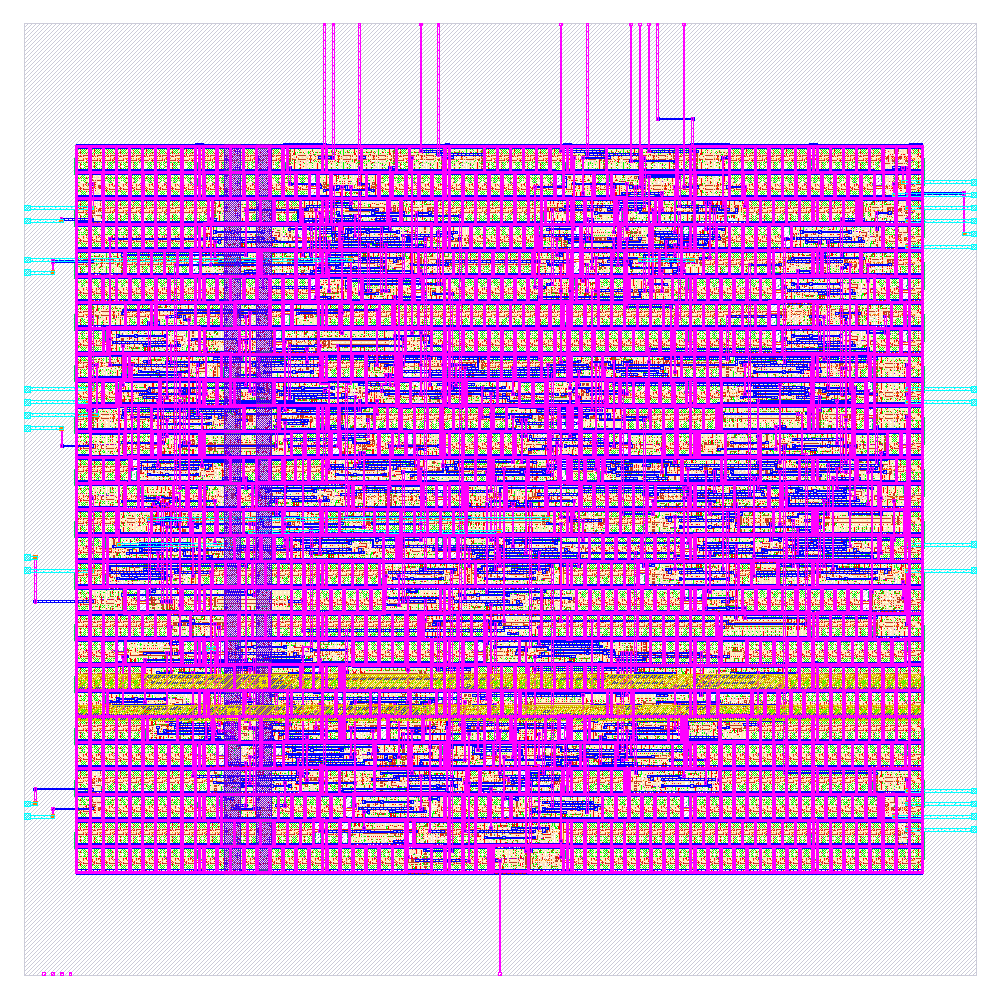

# Báo cáo RTL-to-GDSII

## 1. Phạm vi và điều kiện chạy

| Thuộc tính | Giá trị |
|---|---|
| Run ID | `RUN_2026-10-20_07-49-51` |
| Top | `tt_um_eee703128_24100665` |
| RTL | `rtl/project.sv` |
| Config | `config.json` |
| PDK / thư viện | `sky130A` / `sky130_fd_sc_hd` |
| Clock | `clk`, chu kỳ 1000 ns (1 MHz) |
| Die khai báo | 100 × 100 µm (10,000 µm²) |
| Log mô phỏng | [`GDS/simulation.log`](../GDS/simulation.log) |
| Log flow | [`GDS/runs/RUN_2026-10-20_07-49-51/flow.log`](../GDS/runs/RUN_2026-10-20_07-49-51/flow.log) |
| Metrics cuối | [`GDS/runs/RUN_2026-10-20_07-49-51/final/metrics.json`](../GDS/runs/RUN_2026-10-20_07-49-51/final/metrics.json) |

Testbench Icarus trong lần chạy này in `PASS` cho reset, nạp khung, quét/giải mã, blank số 0
đầu, BCD không hợp lệ và brightness. Flow báo `Flow complete`; GDS cuối cùng có tại
[`GDS/runs/RUN_2026-10-20_07-49-51/final/gds/tt_um_eee703128_24100665.gds`](../GDS/runs/RUN_2026-10-20_07-49-51/final/gds/tt_um_eee703128_24100665.gds).

## 2. Kết quả tổng hợp và physical

| Chỉ số | Giá trị | Giai đoạn / nguồn |
|---|---:|---|
| Synthesis cells | 176 | Yosys, trước P&R |
| Flip-flop | 43 | Yosys |
| Synthesis cell area | 2337.2416 µm² | Yosys |
| Physical instances | 1312 | Final metrics, gồm filler/tap/buffer |
| Trong đó standard-cell area | 3503.36 µm² | Final metrics |
| Die area | 10,000 µm² | Final metrics |
| Instance utilization | 51.81% | Final metrics |
| Routed wirelength | 5232 µm | Final metrics |

Số instance physical bao gồm 952 filler và 90 tap cells; không dùng tổng 1312 như số logic
cell của RTL.

## 3. Timing và công suất

Tóm tắt STA theo góc PVT và điều kiện SDC nằm trong [`sta/README.md`](sta/README.md).
Ước lượng power nằm trong [`power/README.md`](power/README.md).

Lưu ý quan trọng: `config.json` không chỉ định PNR/signoff SDC. Log flow xác nhận đã dùng
generic fallback SDC. Clock 1 MHz lấy từ cấu hình; delay I/O 200 ns và uncertainty 0.25 ns
là giả định của SDC fallback, không phải yêu cầu giao diện đã được xác nhận.

## 4. Kiểm tra vật lý

| Kiểm tra | Kết quả trong run |
|---|---|
| Detailed routing DRC | 0 lỗi cuối |
| Magic DRC | 0 lỗi |
| KLayout DRC | 0 lỗi |
| LVS | Netgen: `Circuits match uniquely`; device/net differences = 0 |
| Antenna violations | 0 |
| Setup / hold violation checker | Không tìm thấy vi phạm |
| GDS streamout | Có GDS Magic, KLayout và final |
| Flow error log | Rỗng (0 byte) |

Netgen log cũng ghi “4 disconnected pins” trong phần thống kê circuit, dù kết luận so khớp
duy nhất và metrics báo không có critical disconnected pin hay unmatched nets/devices. Giữ lại
chi tiết này để người đọc có thể đối chiếu; không diễn giải kết quả thành sign-off.

## 5. Hình render

Hình dưới là render layout do flow tạo, dùng để quan sát bố trí và routing; ảnh không thay thế
GDS, báo cáo DRC/LVS hoặc kiểm tra chức năng.

## 6. Cảnh báo và kết luận

- Flow hoàn tất nhưng có **448 lint warnings**. Không có lint errors; cần xem chi tiết tại
  [`01-verilator-lint/verilator-lint.log`](../GDS/runs/RUN_2026-10-20_07-49-51/01-verilator-lint/verilator-lint.log).
- SDC fallback được dùng do chưa khai báo `PNR_SDC_FILE` và `SIGNOFF_SDC_FILE`; timing cần được
  chạy lại với constraint được duyệt cho hệ thống đích trước khi dùng làm kết luận thiết kế.
- Power là ước lượng tool. Không có xác nhận trên board hoặc silicon.
- Kết quả mô phỏng, P&R, DRC, LVS và GDS này chỉ áp dụng cho top TinyTapeout của run này;
  không áp dụng cho core `j04_display_core`.

Run đã tạo được GDS và hoàn tất các checker vật lý được cấu hình. Đây **không** phải tuyên bố
ASIC sign-off, tape-out, khả năng chế tạo hay kiểm chứng trên silicon.

